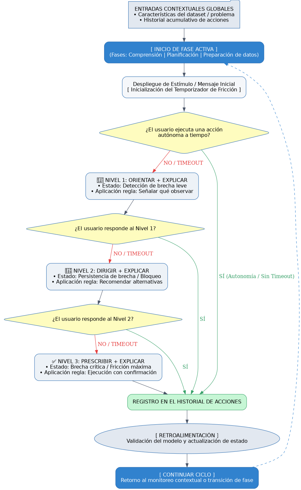

# SiGAD: fase Problema visual y adaptativa

La fase 1 implementada en `fase1.py`, `motor_fase1.py` y `front/fase1.js` sustituye
el flujo anterior basado en temporizadores. Los diagramas y reglas históricas que
aparecen más abajo describen el prototipo previo; para la fase 1 rigen las reglas
de esta sección. La fase 2 usa ahora sesiones y el mismo flujo de cuatro módulos. La fase 3 conserva su flujo existente.

## Fase 2 · Plan adaptativo

Implementación: `fase2.py`, `motor_fase2.py` y `front/fase2.js`.
La interfaz comparte la franja PPDAC y los paneles de la fase 1. Los botones
compactos de variables permiten elegir varias columnas; un segundo clic las quita.
Todas las columnas elegidas se resaltan en la muestra. Una ficha situada bajo los
botones muestra la última variable pulsada: significado, rol, ejemplos, faltantes
(con porcentaje), atípicos candidatos y rango cuando corresponde. Los paneles
permiten desplazarse sin mover la ficha de su zona de consulta.

A la derecha aparecen las primeras cinco filas y decisiones de preparación por
cada variable seleccionada: revisar faltantes, planificar imputación o analizar
registros completos; revisar atípicos; conservar unidades o evaluar escalado;
organizar fechas, categorías, identificadores o coordenadas. Solo se habilitan
las opciones pertinentes al diagnóstico. No se ejecutan tratamientos en esta fase.
El plan se evalúa a partir de la selección y las decisiones; la nota escrita es
opcional. El servidor guarda este borrador en la sesión mediante
`POST /api/fase2/borrador`, con control de revisión y sin actualizar BKT.

El laboratorio visual reemplaza los menús de faltantes y atípicos por gráficos
interactivos y decisiones que se añaden al plan. `GET /api/fase2/calidad` recibe
una variable y devuelve disponibilidad por periodo y una muestra de mediciones;
con `fila` devuelve vecinos de la misma estación en el orden original del archivo.
Los periodos sin registros se distinguen de las celdas sin valor. Los candidatos
atípicos no se consideran errores confirmados; se limita su visualización y se
indica la muestra utilizada. No se interpolan valores ni se elimina información.

Los gráficos de calidad incluyen tres referencias: promedio (azul), Q1 y Q3
(discontinuas). En la curva se calculan sobre las medias de periodos con datos;
en la dispersión, sobre todos los registros numéricos válidos. La interfaz declara
esta diferencia. Las medias de periodo fuera de Q1−1,5×IQR o Q3+1,5×IQR se marcan
como candidatas a atípicas, separadas de los candidatos de los registros originales.
Superar Q3 o caer por debajo de Q1 no se interpreta por sí solo como un error.

La ayuda visual es contextual y local: Autónomo permite explorar; Orientar añade
una pista; Dirigir destaca un periodo o candidato y facilita comparaciones;
Prescribir explica una revisión propuesta que el usuario puede adoptar. El grado
procede del backend y se registra al guardar las decisiones. No se consulta el LLM
para estas pistas ni se cierra automáticamente el plan en el nivel 4. La evaluación
formal sigue usando el evaluador configurado. El temporizador de la interfaz de
fase 2 está desactivado: leer un gráfico no aumenta el nivel. Las decisiones de
escalas y organización quedan agrupadas en una sección desplegable.

La muestra se obtiene mediante `GET /api/fase2/muestra` con `X-SiGAD-Phase2` y no
se envía al LLM. La selección estructurada sí se incluye en la entrada del evaluador.

Al pulsar «Continuar a la fase 2», el servidor recupera el objetivo confirmado
mediante la sesión de Problema. No acepta un objetivo sustituido desde el navegador.
Conserva el progreso al volver a entrar desde la misma tarea de fase 1.

El flujo tiene cuatro responsabilidades:

1. Evaluación LLM con una rúbrica versionada de coherencia con la pregunta,
   calidad, escalado y estructura. Recibe la propuesta, diagnóstico calculado,
   objetivo, variables, apoyo recibido e historial de los últimos cinco intentos.
   El backend valida puntuaciones, explicaciones, columnas y estructura del plan.
2. BKT independiente de Problema, con las cuatro habilidades del Plan. Cada
   puntuación 2 aporta un acierto y 0/1 un error; los parámetros siguen sin calibrar.
3. Política del backend: empieza en Autónomo y aumenta un grado ante dificultad
   o petición de ayuda. La inactividad también aumenta el apoyo, sin actualizar
   conocimiento. Ni el cliente ni el LLM seleccionan el grado.
4. Generación LLM: Orientar produce una pista; Dirigir ofrece tres alternativas
   viables; Prescribir entrega un plan explicado. Elegir o recibir un plan no
   aporta evidencia de dominio. El estudiante puede escribir su propia propuesta
   también en Dirigir.

El diagnóstico respeta los roles de columnas de fase 1 y usa una copia estable
sobre la que calcula faltantes, candidatos a atípicos y rangos. Considera fechas,
categorías y coordenadas candidatas. No obliga a tratar columnas ajenas al objetivo,
ni a eliminar atípicos o escalar por la mera diferencia de rangos.

El plan confirmado conserva origen (usuario/sugerido/prescrito), pasos, columnas,
justificaciones, objetivo y versión del dataset. Se guarda en la sesión del
servidor y en `sigad_fase2_plan` de sessionStorage para la futura interfaz de
fase 3. `ejecutado=false`: confirmar el plan no modifica datos ni inicia la fase 3.
La integración de la ejecución técnica con este plan sigue pendiente.

API nueva: `POST /api/fase2/sesion` recibe `X-SiGAD-Session` de Problema.
`GET /api/fase2/estado` y `POST /api/fase2/evaluar`, `/accion`, `/apoyo`,
`/seleccionar` reciben `X-SiGAD-Phase2`. Las mutaciones requieren revisión; evaluar
requiere un identificador de intento. Repetir el mismo intento es idempotente;
reutilizarlo para otra propuesta devuelve 409. Errores de proveedor o esquema
no penalizan al estudiante y permiten reintentar. Los endpoints antiguos
`evaluar-estrategia` y `explicar-alternativa-correcta` devuelven 410.

Las sesiones se mantienen en memoria (hasta 500); reiniciar el servidor pierde
el progreso. Se depuran las inactivas por más de 24 horas al crear una sesión.
La validación estructural no sustituye la validación empírica de la rúbrica y
los contenidos del LLM. Configuración BKT: `app.config['FASE2_BKT']`.
Las secciones históricas de fase 2 que aparecen más abajo corresponden al flujo
anterior y no describen esta implementación.

## Ejecutar

Desde la raíz del proyecto, con un Python funcional:

```bash
python3 -m venv .venv
source .venv/bin/activate
python -m pip install -r requirements.txt
python app.py
```

Abre `http://127.0.0.1:5000`. La exploración no requiere llamadas al proveedor.
La evaluación y la generación del apoyo utilizan el cliente Groq configurado
en `agente.py` y necesitan las credenciales que ya usa ese cliente.
No se envía el CSV completo: se envían la respuesta, el perfil y los resúmenes
del gráfico seleccionado. No publiques las credenciales.

El dataset predeterminado es `Data/Data.csv`, resuelto desde la ubicación de
`app.py`. Para utilizar otro archivo, configura `SIGAD_CSV_PATH` con una ruta
absoluta o relativa al proyecto. Si falta el archivo, el inicio explica el error.

## Exploración visual

Todas las vistas de fase 1 admiten selección múltiple con los botones de variables.
Patrones cíclicos, Distribución y Variabilidad muestran un panel por medida;
Frecuencias muestra un panel por categoría. Relaciones compara todas las parejas
sin repetirlas y declara las parejas sin observaciones suficientes. Comparar
categorías conserva una variable de agrupación y permite seleccionar varias
medidas. Los grupos de más de doce gráficos se recorren con paginación. Cada panel
conserva sus unidades y escalas; no se superponen histogramas de unidades distintas.
Las selecciones compatibles se conservan al cambiar de vista durante la sesión
abierta; el backend persiste la selección de la vista activa. Las llamadas antiguas
sin `variables` siguen funcionando. Explorar o cambiar la selección no modifica BKT.

En Evolución temporal se pueden seleccionar varias medidas con los botones de
variables, y quitarlas con otro clic. Las medias mensuales se dibujan en el mismo
gráfico con colores, leyenda y detalle por punto. La selección se conserva en la
sesión y en el contexto entregado al evaluador. Se mantienen las unidades y valores
originales; no se normaliza automáticamente. Los huecos de observación interrumpen
las líneas, también cuando se superponen varias series. Quitar la última serie
muestra un estado vacío y deshabilita evaluar hasta elegir al menos una medida.
La API acepta `variables` como lista en el contexto y parámetros `variables`
repetidos en `/api/fase1/grafico`; las llamadas anteriores de una variable siguen
siendo válidas. Las demás vistas mantienen sus selecciones específicas.


La fase 1 distingue medidas, categorías, componentes temporales, identificadores
y coordenadas candidatas a partir del nombre y tipo de columna. Esta detección
es heurística: el significado debe confirmarse con el diccionario de datos.
`No` no se analiza como medida; `year/month/day/hour` construyen el tiempo.
`wd` y `station` admiten frecuencias (barras) y comparación de una medida
numérica (media por categoría). Si solo existe una estación, se muestra su
conteo y se advierte que no hay grupos para contrastar. Los faltantes se excluyen
y se declaran los límites para categorías numerosas en la nota del gráfico.

El perfil detecta pares latitud/longitud por nombres habituales y comprueba
rangos geográficos. Informa si coinciden con fechas válidas; no deduce ubicaciones
desde `station`. Esta versión identifica las condiciones espaciales, pero todavía
no incorpora mapas ni filtros de fecha para mapas. Los CSV se seleccionan con
`SIGAD_CSV_PATH`; no se ha añadido un cargador de archivos en la interfaz.

- Variables agrupadas y nombres completos al pulsarlas. Las variables numéricas
  seleccionadas cambian los gráficos; las categóricas muestran su descripción.
  Los significados conocidos corresponden al dataset PRSA; cualquier columna
  desconocida se muestra como significado pendiente de confirmar.
- Perfil precalculado: cobertura temporal, fechas inválidas y repetidas,
  intervalo predominante, irregularidad y faltantes por variable.
- Cinco vistas disponibles según los datos: evolución (media mensual), patrones
  cíclicos (mes × hora), distribución, variabilidad (cajas mensuales) y relaciones
  (dispersión con segunda variable). Se muestra una vista a la vez.
- Los promedios excluyen faltantes, conservan los meses vacíos como huecos y
  muestran cantidades de observaciones en los detalles de las marcas. Cajas y
  mapas de calor agrupan años. La dispersión limita el render a 800 registros
  espaciados por filas y declara esa limitación. No se infieren unidades.
- Perfil y resúmenes se calculan sobre una copia del dataset de entrada; cambios
  posteriores en fases 2/3 no reescriben esta exploración inicial.

## Reglas pedagógicas y BKT

La primera tarea empieza en Autónomo. Orientar presenta pistas; Dirigir propone
una acción; Prescribir ofrece un ejemplo explicado que el usuario debe adaptar.
El usuario no elige manualmente el nivel. El backend controla las transiciones.

La respuesta contiene un único campo: la pregunta. En ella el usuario debe expresar
qué desea conocer, las variables y el alcance relevante. El LLM puntúa
cuatro habilidades (propósito, alcance, variables y viabilidad) de 0 a 2. El
backend valida el esquema y las columnas devueltas. Cada puntuación 2 se convierte
en observación correcta de su habilidad; 0/1, en incorrecta. Una respuesta
insuficiente escala exactamente un grado en la misma tarea, hasta Prescribir.
Solicitar ayuda también escala un grado, sin actualizar BKT. Si transcurren 30
segundos sin respuesta, el sistema escala un grado sin actualizar BKT: la
inactividad no demuestra un error de conocimiento. La selección de gráficos y los errores de red/proveedor no
son evidencia de error.
El flujo mantiene cuatro responsabilidades:

1. Evaluación LLM: recibe la consigna, respuesta, rúbrica versionada por habilidad,
   cobertura, metadatos y faltantes, operaciones disponibles, gráfico resumido,
   grado y contenido de la ayuda recibida y hasta cinco intentos anteriores.
   El backend valida la salida antes de admitirla como evidencia.
2. BKT: convierte 2 en acierto y 0/1 en error y actualiza el dominio por habilidad.
3. Política: selecciona el grado y expone la regla aplicada en `motor.decision`.
4. Generación LLM: recibe el grado, contexto, respuesta, evaluación, dominio y
   ayuda previa. En Orientar redacta una pista; Dirigir y Prescribir conservan
   las opciones y la selección explicada. El LLM no modifica BKT ni el grado.

`POST /api/fase1/apoyo` genera y conserva la pista de Orientar, con control de
revisión y sin actualizar BKT. Una salida inválida del generador devuelve 502;
se conserva una pista contextual predeterminada para permitir continuar.
La entrada de cada evaluación queda registrada en el historial de la sesión.
Las validaciones estructurales no garantizan por sí solas la corrección semántica
ni pedagógica del contenido; la rúbrica y el evaluador requieren validación.

Cada intento aceptado actualiza una sola vez la probabilidad de cada habilidad:
posterior bayesiano según slip/guess, seguido de la transición de aprendizaje.
Para evitar atribuir al usuario la solución prescrita, los criterios correctos
en Prescribir no actualizan BKT ni agregan evidencia de dominio. Los errores sí
se registran. Aciertos en Orientar/Dirigir se registran como respuestas asistidas.

Al cerrar una tarea, solo se reduce un grado para la siguiente tarea comparable
si **todas** las habilidades superan el umbral y cuentan con evidencia en al
menos dos tareas distintas no prescritas. Los reintentos de la misma tarea no
satisfacen este mínimo. Cerrar una tarea no vuelve a actualizar BKT.

Después del cierre se puede practicar otra pregunta o solicitar una comprobación
sin ayuda. Esta última inicia una tarea diagnóstica autónoma explícita; no cambia
el apoyo habitual hasta cumplir umbral y evidencia, y permite obtener evidencia
propia tras una prescripción. La rúbrica exige una justificación; seleccionar o
copiar una sugerencia no cierra automáticamente la fase. Las preguntas nuevas son
tareas de formulación comparables; aún falta validar empíricamente su equivalencia.

Parámetros iniciales del prototipo: P(L0)=0.5, P(S)=0.15, P(G)=0.25, P(T)=0.15,
umbral=0.85 y evidencia mínima=2. **No están calibrados** para estas habilidades.
Se pueden configurar mediante `app.config['FASE1_BKT']` antes de iniciar el
servidor. El mismo modelo de slip/guess se utiliza en niveles 1–3; falta estimar
parámetros que consideren la ayuda recibida y validar la fiabilidad del evaluador.

El botón de continuación entrega la pregunta y las variables reconocidas a la
fase 2, manteniendo `phase1Objective` para sus endpoints.
Las sesiones se aíslan con un identificador aleatorio por pestaña; el backend
conserva BKT, historial e intentos en memoria. Se restauran al recargar mientras
el servidor siga activo. No hay base de datos: reiniciar el servidor pierde las
sesiones. Se limita el almacenamiento a 500 sesiones y se eliminan inactivas
de más de 24 horas al crear nuevas sesiones.

## Verificar sin llamadas al proveedor

```bash
python -m unittest discover -s tests -v
```

Las pruebas sustituyen el LLM por un evaluador simulado y verifican fórmulas,
escalamiento, fading, evidencia de tareas distintas, prescripción, duplicados,
aislamiento de sesiones, errores, gráficos y conservación del objetivo.

---

# 🧠 Arquitectura histórica del Motor de Guidance Contextual

El **Motor de Guidance** opera de manera transversal a lo largo de tres fases del ciclo analítico: **Fase 1 (comprensión del problema)**, **Fase 2 (planificación)** y **Fase 3 (preparación de datos)**. La Fase 3 agrupa cuatro subprocesos: `Fase3Nulos`, `Fase3Outlier`, `Fase3Normalizacion` y `Fase3Transformacion`.

---

## ⚙️ 1. Lógica y Reglas Operativas del Motor

El motor opera como un sistema de toma de decisiones adaptativo que regula la interacción entre el usuario y las fases analíticas mediante las siguientes reglas internas:

### A. El Ciclo de Inicialización y el Contexto Global
*   **Ingreso al Estado Activo (`[ INICIO DE FASE ACTIVA ]`)**: El sistema identifica la etapa analítica actual del usuario y carga las directrices correspondientes.
*   **Inyección de Entradas Contextuales**: El núcleo de decisión recopila en tiempo real dos variables de estado clave:
    1. *Las características del dataset o problema actual* (para calibrar la complejidad técnica).
    2. *El historial acumulativo de acciones* (la memoria de interacciones previas, aciertos y niveles de ayuda consumidos).
*   **Temporizador de Fricción**: Se despliega el estímulo inicial de la fase y se arranca un cronómetro interno para medir el tiempo que tarda el usuario en dar una respuesta autónoma.

### B. La Regla de Decisión 0: La Ruta del Éxito (Sin Timeout)
Una vez iniciado el temporizador, el motor evalúa si el usuario ejecuta una acción autónoma a tiempo:
*   **Condición (SÍ)**: Si el usuario responde o resuelve el requerimiento de forma independiente *antes* de que expire el tiempo límite.
*   **Comportamiento del Sistema**: 
    *   **Omisión de Escalada**: El motor valida que el usuario cuenta con el dominio necesario, bloqueando y omitiendo por completo los niveles de ayuda (Niveles 1, 2 y 3).
    *   **Registro Directo**: La acción autónoma se captura y se envía de inmediato al registro histórico.
    *   **Continuidad**: Se da por superada la fase y se emite la señal para avanzar a la siguiente etapa del análisis.

### C. La Regla de Escalada Gradual (Ante Demoras o Timeout)
Si el temporizador expira sin aportes del usuario (**Respuesta NO / Timeout**), el sistema interpreta una brecha cognitiva o bloqueo, activando un andamiaje progresivo:
*   🎯 **Nivel 1 (Orientar + Explicar / Brecha Leve)**: Aplica la regla de *señalar qué observar*. El sistema filtra el contexto y muestra pistas sobre qué variables o métricas atender sin dar la respuesta directa.
*   🔀 **Nivel 2 (Dirigir + Explicar / Bloqueo Persistente)**: Aplica la regla de *recomendar alternativas*. Si el Nivel 1 falla, el sistema ofrece rutas metodológicas alternas justificando el impacto de cada opción.
*   ✅ **Nivel 3 (Prescribir + Explicar / Fricción Crítica)**: Aplica la regla de *acción con confirmación*. Ante un bloqueo total, el sistema formula o ejecuta una solución técnica directa solicitando confirmación explícita y explicando su fundamento.

### D. Convergencia y Cierre del Ciclo
Independientemente de la ruta tomada (la autónoma directa o cualquiera de los niveles de ayuda), **todas las interacciones convergen obligatoriamente en un único punto**: el registro en el historial. Esto actualiza la memoria de la sesión, valida el modelo mediante retroalimentación y da la orden de continuar el ciclo.

---

## 📊 2. Diagrama de Flujo del Motor (Graphviz)

Puedes renderizar este flujo copiando el siguiente código en plataformas compatibles como [GraphvizOnline](https://dreampuf.github.io/GraphvizOnline/):



---

## 🚀 3. Implementación actual: Fases 1, 2 y 3

Las fases 1 y 2 implementan el tutor pedagógico para formular una pregunta viable y definir una estrategia. La Fase 3 ejecuta la preparación técnica del CSV: limpieza de nulos, limpieza de outliers, normalización y transformación temporal.

### Objetivo

1. Cargar y clasificar las variables del dataset.
2. Recibir una duda del estudiante.
3. Verificar con un LLM si puede responderse con esas variables.
4. Escalar la ayuda de forma gradual si la pregunta no es viable o si vence el tiempo.
5. Registrar preguntas, decisiones y retroalimentación de la sesión.

### Arquitectura

```text
Navegador (front: HTML + CSS + JavaScript + D3 preparado)
                    │
                    ▼
           Flask: app.py (API local)
             │                    │
             ▼                    ▼
  Pandas + archivo CSV       agente.py + prompts.py
                                  │
                                  ▼
                         Groq / modelo LLM
```

El navegador nunca recibe la clave de Groq. Las llamadas al LLM se realizan exclusivamente desde Flask/Python.

### Archivos involucrados

| Archivo o carpeta | Responsabilidad |
| --- | --- |
| `app.py` | API Flask, lectura del CSV, taxonomía de variables, publicación del frontend y rutas que invocan el agente. |
| `agente.py` | Clase `MotorAnalisis`: consulta la API local y se comunica con Groq. |
| `prompts.py` | Prompts pedagógicos para validar preguntas, describir variables, sugerir y prescribir consultas. |
| `main.py` | Versión de consola para el análisis de normalización de la Fase 3. |
| `front/index.html` | Estructura de la interfaz web. |
| `front/styles.css` | Diseño responsive de la interfaz. |
| `front/app.js` | Máquina de estados del frontend, temporizador, historial y llamadas `fetch` a Flask. |
| `main_fase3.py` | Script de consola para probar `Fase3Outlier`. |
| `estado_fase1.json` | Registro generado por la versión de consola; almacena variables, preguntas, eventos y estado temporal. |

---

## 🧭 4. Flujo pedagógico de la Fase 1

La versión web usa un contador interno de **30 segundos** por interacción. El tiempo no se muestra en pantalla; su vencimiento puede aumentar el apoyo sin modificar BKT.

### Nivel 1 — Preguntar y validar

El sistema muestra el mensaje:

```text
Escribe tu pregunta o duda para analizar el CSV
```

El LLM recibe la pregunta y la taxonomía de variables. Después explica una de estas situaciones:

- `✅ Muy buena pregunta`: se puede responder con las columnas disponibles.
- `⚠️ La pregunta necesita precisión`: hay ambigüedad y se indica qué debe aclararse.
- `❌ Esta pregunta no se puede responder`: faltan variables o información necesaria.

Si vence el temporizador o la pregunta no es viable, el flujo pasa al Nivel 2.

### Nivel 2 — Orientar con variables y validar de nuevo

El sistema muestra todas las variables clasificadas como temporales, numéricas y categóricas. Después solicita al LLM una descripción breve de cada una: qué representa, qué puede medir o, cuando no se puede saber con certeza, una inferencia explícita.

El estudiante responde nuevamente a:

```text
¿Qué consulta desearías saber con estas variables?
```

La nueva pregunta se valida y explica con las mismas reglas del Nivel 1. Si vuelve a fallar o expira el tiempo, se activa el Nivel 3.

### Nivel 3 — Dirigir con cuatro preguntas viables

El LLM genera exactamente cuatro preguntas diferentes que pueden responderse con el dataset y que son coherentes con la variable, el gráfico y la cobertura seleccionados. Para cada una informa:

- La pregunta propuesta.
- Las variables que conecta.
- El motivo o utilidad de analizarla.

El estudiante elige una de las cuatro tarjetas. La pregunta queda definida como la consulta con la que continuará el análisis, pero la selección asistida no se registra como dominio en BKT.

### Nivel 4 — Prescribir una pregunta

Este nivel se activa cuando el motor pedagógico detecta que hace falta apoyo completo. El LLM compara las cuatro opciones, selecciona la más clara y viable y la interfaz presenta **“Analizaremos esta pregunta”** con una justificación. La prescripción tampoco se registra como dominio en BKT.

---

## 🌐 5. Interfaz web

La interfaz se sirve desde Flask y se abre en:

```text
http://127.0.0.1:5000
```

Incluye la franja horizontal de fases PPDAC, mensajes de retroalimentación, tarjetas de variables, cinco visualizaciones y cuatro preguntas sugeridas cuando se activa Dirigir. El contador funciona internamente y no ocupa espacio visual.

La etiqueta de D3.js ya está incluida en `front/index.html`:

```html
<script src="https://cdn.jsdelivr.net/npm/d3@7"></script>
```

Por ello, las visualizaciones futuras pueden crearse en `front/app.js` usando el objeto global `d3`, sin cambiar la arquitectura del frontend.

El frontend apunta a Flask incluso si se abre con Live Server o una vista previa del IDE. Flask incluye cabeceras CORS para estas pruebas locales.

---

## 🔌 6. Endpoints de la API

| Método | Ruta | Uso |
| --- | --- | --- |
| `GET` | `/` | Sirve la interfaz web. |
| `GET` | `/api/tarjeta-identidad` | Filas, columnas, peso y cobertura temporal del CSV. |
| `GET` | `/api/diagnostico-calidad` | Nulos, outliers y estructura temporal. |
| `GET` | `/api/taxonomia-variables` | Variables agrupadas en temporales, numéricas y categóricas. |
| `POST` | `/api/validar-pregunta` | Valida una pregunta. Cuerpo: `{ "pregunta": "..." }`. |
| `GET` | `/api/describir-variables` | Devuelve la explicación breve de cada variable. |
| `GET` | `/api/preguntas-sugeridas` | Genera tres preguntas viables con sus motivos. |
| `POST` | `/api/prescribir-pregunta` | El LLM escoge una de tres preguntas. Cuerpo: `{ "preguntas": ["...", "...", "..."] }`. |
| `POST` | `/api/fase2/evaluar-estrategia` | Evalúa la estrategia de preparación de la Fase 2. |
| `GET` | `/api/fase3/analizar-nulos-columna` | `Fase3Nulos`: analiza nulos de una columna. |
| `POST` | `/api/fase3/analizar-batch-nulos` | `Fase3Nulos`: resume nulos de varias columnas. |
| `POST` | `/api/fase3/analizar-batch-outliers` | `Fase3Outlier`: detecta outliers mediante IQR. |
| `POST` | `/api/fase3/analizar-batch-normalizacion` | `Fase3Normalizacion`: resume escalas numéricas. |
| `POST` | `/api/fase3/transformar-tiempo` | `Fase3Transformacion`: crea la columna `datetime`. |

---

## ▶️ 7. Instalación y ejecución

### Requisitos

- Python 3.11 o compatible.
- Entorno Conda `vis`.
- Paquetes: `flask`, `pandas`, `numpy`, `requests`, `openai` y `python-dotenv`.
- Archivo CSV en la ruta definida por `CSV_PATH` dentro de `app.py`.
- Una clave válida de Groq en `.env`.

Ejemplo de `.env`:

```env
OPENAI_API_KEY=tu_clave_de_groq
```

Instalación de dependencias:

```bash
conda activate vis
python3 -m pip install openai python-dotenv requests flask pandas numpy
```

Inicio del servidor y frontend:

```bash
conda activate vis
python3 app.py
```

Luego abre `http://127.0.0.1:5000` en el navegador.

Para probar únicamente la versión de terminal:

```bash
conda activate vis
python3 main.py
```

### Si el navegador muestra un error de conexión

1. Confirma que Flask siga ejecutándose en la terminal.
2. Reinicia Flask después de modificar `app.py`.
3. Recarga el navegador sin caché con `⌘ + Shift + R`.
4. Comprueba que el frontend use `http://127.0.0.1:5000` o que Flask esté activo si lo abres desde una vista previa del IDE.

---

## ✅ 8. Casos de prueba recomendados

| Caso | Acción esperada |
| --- | --- |
| Pregunta viable | El LLM la valida en el Nivel 1 y termina la Fase 1. |
| Pregunta no relacionada | El sistema explica la limitación y avanza al Nivel 2. |
| Timeout en el Nivel 1 | Muestra variables y explicaciones en el Nivel 2. |
| Segunda pregunta viable | El LLM la valida en el Nivel 2 y termina la Fase 1. |
| Timeout o pregunta no viable en el Nivel 2 | Presenta cuatro preguntas en el Nivel 3. |
| Selección del usuario en el Nivel 3 | Guarda la pregunta elegida como consulta final. |
| Timeout en el Nivel 3 | El LLM prescribe la mejor opción en el Nivel 4 con justificación. |

---

## 🔐 9. Consideraciones de seguridad y alcance

- No subas el archivo `.env` ni la clave de Groq al repositorio.
- La aplicación actual está pensada para pruebas locales; antes de desplegarla se deben restringir CORS, proteger los endpoints y validar límites de uso del LLM.
- La Fase 1 clasifica, orienta y valida preguntas; la Fase 2 evalúa la estrategia; la Fase 3 concentra las operaciones de preparación de datos (`Fase3Nulos`, `Fase3Outlier`, `Fase3Normalizacion` y `Fase3Transformacion`).
### Ayuda adaptativa en la fase Problema

El motor pedagógico y BKT determina el nivel de ayuda. El LLM no cambia el nivel: solo genera contenido compatible con la decisión del motor y con las variables, la vista y la cobertura disponibles.

- **Nivel 1 · Autónomo:** el estudiante formula una pregunta sin orientación.
- **Nivel 2 · Orientar:** recibe una pista breve y todavía escribe su pregunta.
- **Nivel 3 · Dirigir:** el LLM propone exactamente cuatro preguntas viables. El estudiante escoge una y la fase se completa como selección asistida.
- **Nivel 4 · Prescribir:** el LLM selecciona la alternativa más clara y viable entre esas cuatro. La interfaz presenta “Analizaremos esta pregunta” y permite continuar.

Elegir una sugerencia o recibir una prescripción no se registra como dominio en BKT. Solo las respuestas formuladas y evaluadas por el estudiante aportan evidencia positiva de aprendizaje.
