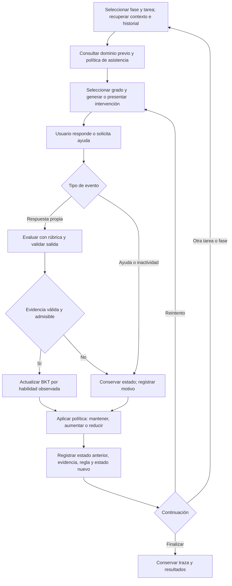

# Propuesta revisada de SiGAD

Documento de trabajo elaborado a partir de las figuras aportadas y de `motor_fase1.py`, `agente.py`, `prompts.py` y `Readme.md`. Distingue el comportamiento implementado de las mejoras propuestas. No modifica la aplicación ni constituye validación empírica.

## 1. Formulación de la propuesta

SiGAD propone una arquitectura computacional de guiado contextual y adaptativo para apoyar actividades de investigación con datos. El proceso se organiza mediante PPDAC. Los principios de andamiaje fundamentan una política explícita de asistencia; BKT estima el dominio de habilidades a partir de evidencias del desempeño; el motor selecciona el grado de apoyo; y un componente generativo produce orientación metodológica compatible con esa decisión y con los datos disponibles. La interacción genera nuevas evidencias que retroalimentan la estimación y la política.

El alcance conceptual abarca PPDAC. La fase Problema constituye la implementación examinada en este documento; no se presupone que las demás fases dispongan ya de una evaluación equivalente.

## 2. Responsabilidades y contratos

| Responsabilidad | Entrada | Salida | Restricción |
|---|---|---|---|
| Fundamento pedagógico | Principios de contingencia, retirada progresiva y transferencia de responsabilidad | Criterios para diseñar la política | Es un fundamento de diseño, no una llamada del pipeline |
| Contexto y cálculo | Datos, fase, tarea y decisiones previas | Variables, cobertura, resúmenes calculados y restricciones | Los valores verificables proceden del backend |
| Evaluación de evidencia | Respuesta propia, contexto y rúbrica | Puntuaciones, justificación y validez de la evaluación | Una salida inválida no se transforma en error del usuario |
| Estimación BKT | Estado por habilidad y evidencia admisible | Dominio actualizado por habilidad | No selecciona el grado de ayuda |
| Política de asistencia | Dominio, desempeño, ayuda recibida, historial y contexto | Grado, acción y regla aplicada | Decisión explícita y registrable |
| Generación de orientación | Grado seleccionado, contexto y restricciones | Pista, opciones, explicación o ejemplo | No modifica probabilidades ni decide cambios de grado |
| Interfaz y registro | Intervención validada | Interacción y traza del evento | Finalización asistida y dominio demostrado se registran por separado |

El mismo LLM puede evaluar y redactar, pero mediante operaciones y contratos separados. En nivel Autónomo no debe introducir pistas que conviertan una respuesta en asistida.

## 3. Habilidades de la fase Problema

Propuesta operativa basada en los cuatro criterios actuales. Los descriptores necesitan revisión y prueba piloto; todavía no son un instrumento validado. Considerarlos habilidades separadas y rastreables por BKT es una hipótesis de modelado que debe justificarse.

| Habilidad | Evidencia observable | 0 | 1 | 2 |
|---|---|---|---|---|
| Formular el propósito | Expresa qué desea conocer con los datos | Propósito ausente o incompatible con la tarea | Intención reconocible pero ambigua | Pregunta con intención analítica clara |
| Delimitar el alcance | Identifica población, unidad o periodo pertinente | Delimitación contradictoria con el contexto | Delimitación incompleta | Alcance suficiente y compatible con los datos |
| Seleccionar variables | Identifica variables disponibles relacionadas con la pregunta | Variables necesarias inexistentes o incompatibles | Selección parcialmente pertinente | Selección disponible y pertinente |
| Reconocer la viabilidad | Relaciona lo preguntado con lo que permiten datos y diseño | Exige una inferencia que no puede sostenerse | Requiere aclaración o ajuste | Pregunta abordable con los datos y operaciones permitidas |

No exigir todas las delimitaciones en todas las tareas: cada tarea declara qué criterio es aplicable. Si no existe oportunidad de observar una habilidad, registrar «no observada» y no actualizarla. No convertir automáticamente una omisión de información contextual ya proporcionada en desconocimiento.

El evaluador debe valorar la respuesta original antes de reformularla. Una reformulación o alternativa del LLM se presenta como intervención del sistema y no como evidencia producida por el usuario.

## 4. Evidencia y actualización de BKT

### Implementación actual

- Se mantiene una probabilidad por propósito, alcance, variables y viabilidad.
- Puntuación 2 se convierte en evidencia correcta; 0/1 en incorrecta.
- Se aplica el posterior bayesiano y después la transición de aprendizaje.
- Cada intento aceptado actualiza una sola vez.
- Pedir ayuda no actualiza BKT.
- Los aciertos en Prescribir no incrementan el dominio; los errores sí se procesan.
- Los aciertos de los niveles 1–3 utilizan los mismos parámetros.
- El timeout produce una actualización negativa atenuada.

### Recomendación inicial

1. Separar eventos de desempeño, ayuda, inactividad y fallo técnico.
2. Actualizar BKT solo con evaluaciones válidas de habilidades observadas.
3. Conservar 0/1/2 para análisis y documentar explícitamente su conversión binaria. Esta conversión pierde la diferencia entre desempeño parcial e incorrecto.
4. Utilizar evidencia autónoma para acreditar dominio que permita retirar apoyo. Registrar la evidencia asistida por separado; su incorporación a BKT requiere una política y parámetros justificados.
5. No reducir el dominio únicamente por tiempo sin respuesta. Puede ofrecerse ayuda sin atribuir desconocimiento.
6. Después de una prescripción, obtener evidencia mediante una tarea nueva sin ayuda; no atribuir al usuario la solución proporcionada.

Estas recomendaciones son una política conservadora propuesta, no un requisito universal de BKT. En la simulación del modelo estándar, la actualización utiliza conocimiento previo, desliz, adivinación y aprendizaje. Los parámetros actuales —0,50; 0,15; 0,25; 0,15— no están calibrados para estas habilidades.

## 5. Política explícita de asistencia

| Evento o condición | Acción de asistencia propuesta | Tratamiento del conocimiento |
|---|---|---|
| Evaluación inválida o error de proveedor | Mantener y permitir reintento | Conservar estado |
| Solicitud de ayuda | Aumentar un grado, hasta Prescribir | No actualizar por la solicitud |
| Respuesta propia insuficiente con evaluación válida | Aumentar un grado y explicar el criterio no satisfecho | Actualizar solo la evidencia admisible |
| Tarea completada sin evidencia suficiente para retirar apoyo | Mantener para la próxima tarea comparable | Conservar trazabilidad de la ayuda utilizada |
| Tarea completada y habilidades pertinentes por encima del umbral, con evidencia autónoma suficiente en tareas distintas | Reducir un grado en la siguiente tarea comparable | Utilizar la estimación ya actualizada |
| Evidencia insuficiente o no observable | Mantener; solicitar una actividad diagnóstica si procede | No inventar evidencia |
| Inactividad | Ofrecer ayuda; registrar el evento | No actualizar únicamente por el tiempo |
| Grado máximo y dificultad persistente | Revisar prerrequisitos o presentar otro ejemplo | No atribuir como dominio una solución del sistema |

Definir precedencia entre eventos y aplicar una sola decisión por evento. Una tarea diagnóstica autónoma puede ser una excepción explícita al nivel habitual; fallar en ella no debe borrar la información sobre la condición de evaluación.

El umbral 0,85 y el mínimo de dos tareas son configuraciones del prototipo. No presentarlos como valores deducidos de Ceneda, del andamiaje o de BKT. Tampoco llamar «óptima» a la política sin comparación y evidencia de resultados.

## 6. Pipeline de ejecución

El fundamento pedagógico debe acompañar la arquitectura como marco de diseño. La actualización BKT ocurre después de la evaluación y antes de decidir el nuevo apoyo. El flujo permite revisar fases previas según las dependencias de las tareas.

## 7. Registro para auditoría y reproducción

Por evento registrar: identificador de sesión, tarea e intento; fase; habilidad; respuesta original o referencia a ella; puntuación; aplicabilidad del criterio; procedencia y validez de la evidencia; grado recibido; dominio anterior y actualizado; parámetros y versión de política; decisión y regla aplicada; versión del prompt y modelo cuando intervengan; estado de error y fecha.

Usar identificadores idempotentes para impedir actualizaciones duplicadas. Las trazas para análisis deben minimizar datos personales. Reproducir eventos cronológicamente sin utilizar información futura. Un replay bajo otra política permite comparar decisiones, pero no demuestra cómo habría respondido el usuario bajo una ayuda diferente.

## 8. Evaluación técnica controlada

Separar dos comprobaciones: conformidad de la implementación y calidad del contenido. Los resultados esperados de las transiciones se obtienen de la especificación previa, no de las salidas del mismo código.

| Caso | Qué verificar |
|---|---|
| Intento duplicado | No se actualiza dos veces el dominio |
| Fallo de evaluación | No cambia dominio ni ayuda por supuesto error del aprendiz |
| Solicitud de ayuda | Un incremento y estimaciones conservadas |
| Acierto prescrito | No se acredita dominio autónomo |
| Reintentos en una misma tarea | No satisfacen la condición de tareas distintas |
| Dominio bajo, igual y superior al umbral | Se respeta el operador y la condición de evidencia |
| Una habilidad por debajo del umbral | Se respeta el criterio definido para retirar apoyo |
| Cambios de fase | Se conserva el estado de habilidades compartidas y se inicializan las nuevas según especificación |
| Variable inexistente o operación no permitida en una intervención | Se rechaza o identifica la salida antes de presentarla |

Indicadores propuestos: porcentaje de decisiones conformes con la especificación, cobertura de reglas y casos límite, actualizaciones duplicadas e intervenciones con referencias verificables inválidas. La validez metodológica completa de una explicación abierta no se demuestra únicamente con estas comprobaciones.

## 9. Relación con los objetivos acordados

1. Calidad del guiado: cuestionario con criterios seleccionados de GUIAVisWeb.
2. Alfabetización: evaluación de aprendizaje con grupo de comparación y medida inicial.
3. Consistencia del LLM: repeticiones con contexto fijo y comparación de campos estructurados. Separar la consistencia de la evaluación por rúbrica de la consistencia del contenido generado; una evaluación fluctuante altera la trayectoria BKT. Estabilidad no implica corrección.

La evaluación controlada del motor es una validación técnica de la propuesta y puede incorporarse a la metodología sin sustituir automáticamente ninguno de los tres objetivos.

## 10. Antecedentes para fundamentar la redacción

- Van de Pol et al. (2010), principios del andamiaje: https://doi.org/10.1007/s10648-010-9127-6
- Desmarais y Baker (2012), modelado del aprendiz y BKT: https://doi.org/10.1007/s11257-011-9106-8
- Ceneda et al. (2020), diseño del guiado: https://doi.org/10.1111/cgf.14017
- Badrinath et al. (2021), BKT y evaluación de implementaciones: https://educationaldatamining.org/EDM2021/virtual/static/pdf/EDM21_paper_237.pdf

Estos antecedentes fundamentan los componentes; no validan por sí solos los umbrales, la rúbrica o la política específica de SiGAD.
